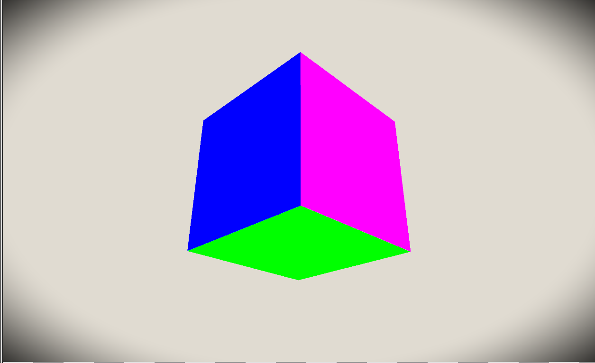
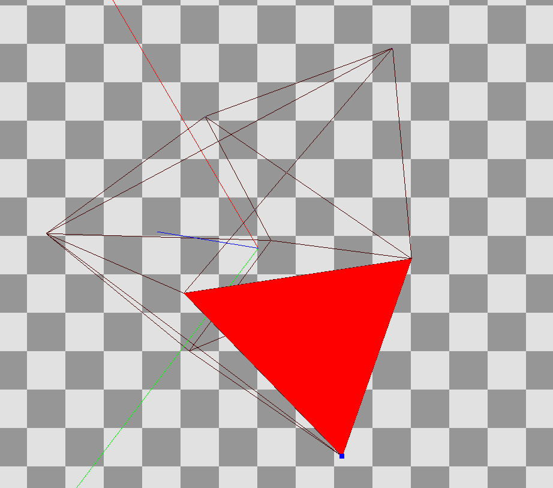

# This is a simple 3D spinning cube renderer built with C# and OpenTK for presentation purposes.


## 📍 Main point of this project:
This project is a practical demonstration created for the **Programming Design** course. Its purpose is to illustrate the abstraction layers of modern graphics APIs (OpenGL, DirectX 12, Vulkan), the operation of the graphics pipeline, and software design patterns for GPU-based rendering.


## 📋 Prerequisites
This project was **built on**:
- **.NET 11 SDK**
- **OpenTK 4.9.4** (restored automatically by `dotnet`)

___(Optional: RenderDoc for frame capture and analysis)___

## ▶️ Usage

From the repository root, run the renderer with:

```sh
dotnet run --project MiniRenderer/MiniRenderer.csproj
```

To inspect a saved frame, open one of the `.rdc` files in `captures/` with RenderDoc. Select a draw call to examine its pipeline state and mesh data. To capture a new frame, launch the renderer through RenderDoc and use its frame-capture hotkey while the window is running.

## 🖼️ Screenshots

The rendered output:



Mesh inspection view in RenderDoc:



## 📈 Current Status

**Done:**
- Cube fragment and vertex shaders are implemented for rendering colored cubes.
- A basic framebuffer system is implemented for off-screen rendering.
- Shader compilation and linking is implemented.
- The two-pass rendering pipeline is implemented.
- Post processing and vignette effects are implemented.
- The main rendering loop and scene management implemented.
- Captures have been added with RenderDoc.

**TODO:**
- Adding comments for presentation.

🪫**Completion status: ~97%**

----
## 🏗️ ClassDiagram (UML)

```mermaid
classDiagram
    class AppWindow {
        -IRenderer _renderer
        -float _angle
        +AppWindow(IRenderer renderer)
        #OnLoad() void
        #OnResize(ResizeEventArgs e) void
        #OnUpdateFrame(FrameEventArgs args) void
        #OnRenderFrame(FrameEventArgs args) void
        #OnUnload() void
        +Main() void$
    }

    class IRenderer {
        <<interface>>
        +Init(int width, int height) void
        +Resize(int width, int height) void
        +BeginFrame() void
        +DrawCube(Matrix4 model, Matrix4 view, Matrix4 projection) void
        +EndFrame() void
    }

    class OpenGLRenderer {
        -Shader _cubeShader
        -Shader _postShader
        -Framebuffer _fbo
        -int _cubeVao
        -int _cubeVbo
        -int _quadVao
        -int _quadVbo
        +Init(int width, int height) void
        +Resize(int width, int height) void
        +BeginFrame() void
        +DrawCube(Matrix4 model, Matrix4 view, Matrix4 projection) void
        +EndFrame() void
        +Dispose() void
    }

    class Shader {
        +int Handle
        +Shader(string vertexPath, string fragmentPath)
        +Use() void
        +SetMatrix4(string name, Matrix4 data) void
        +SetInt(string name, int value) void
        +Dispose() void
    }

    class Framebuffer {
        +int FboHandle
        +int ColorTextureHandle
        +int _rboHandle
        +Framebuffer(int width, int height)
        +Resize(int width, int height) void
        +Bind() void
        +Unbind() void$
        +Dispose() void
    }

    class GameWindow
    class IDisposable {
        <<interface>>
    }

    GameWindow <|-- AppWindow
    AppWindow --> IRenderer : uses
    OpenGLRenderer ..|> IRenderer : implements
    OpenGLRenderer *-- Shader : owns (2x)
    OpenGLRenderer *-- Framebuffer : owns (1x)
    IDisposable <|-- IRenderer
    Shader ..|> IDisposable
    Framebuffer ..|> IDisposable
